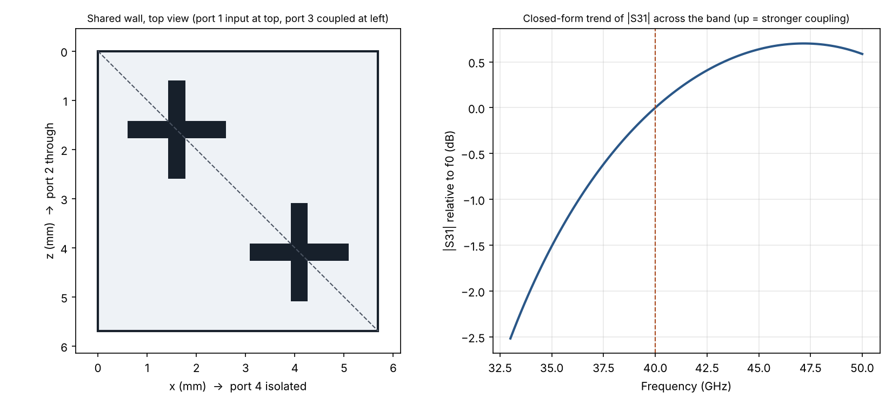
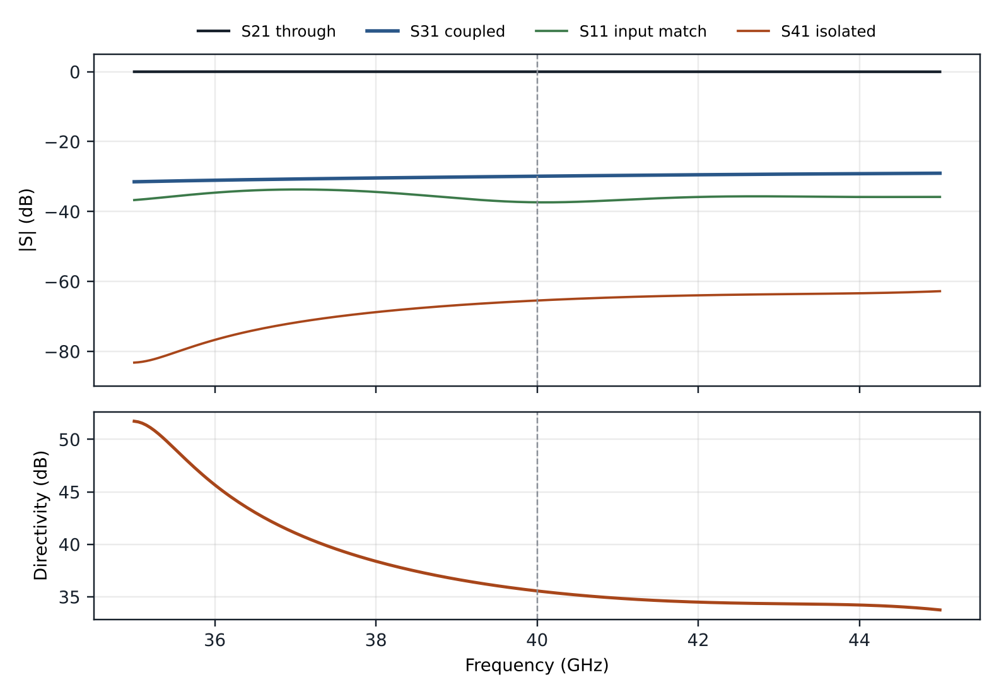

# Moreno cross-guide directional coupler (WR-22, 40 GHz)

Design equations, full-wave models (HFSS scripts and the free openEMS solver),
verification studies and a technical report for a **Moreno cross-guide
coupler**: two rectangular waveguides crossing at right angles, coupled through
two crossed ("+") slots in their common broad wall.

📄 **[Technical report (PDF)](docs/report/Moreno_Coupler_WR22_40GHz_Report.pdf)** —
theory, design calculation, model, convergence study, results, design chart,
tolerances and references.



| | |
|---|---|
| Waveguide | WR-22 (a = 5.690 mm, b = 2.845 mm), band 33–50 GHz |
| Centre frequency | 40 GHz |
| Guide wavelength λg | 9.960 mm |
| Slot spacing Δ = λg/4 | 2.490 mm per axis |
| Slot offset d = (a − Δ)/2 | 1.600 mm |
| Slot centres (x, z) | (1.600, 1.600) and (4.090, 4.090) mm |
| Slot arms, common wall | 2.00 × 0.35 mm, t = 0.25 mm |
| Ports | 1 input · 2 through · 3 coupled · 4 isolated |

<!-- results:start (generated by docs/report/update_readme.py) -->
### Simulated performance at 40 GHz (openEMS, lossless walls)

| Coupling S31 | Directivity | Isolation S41 | Return loss | Through loss |
|---|---|---|---|---|
| **30.04 ± 0.17 dB** | **35.3 ± 0.2 dB** | 65.5 dB | 37.4 dB | 0.008 dB |

Coupling and directivity are bracketed by two mesh-refinement series that converge
from opposite sides (the coupling uncertainty also includes the other numerical
parameters); isolation, return loss and through loss are from the finest mesh
(slot cell 0.0125 mm), and the return loss is a lower bound. Directivity stays above
30 dB from 35.0 to 45.0 GHz. The model passes power-balance
(0.9962–1.0021) and reciprocity (1.8e-03) checks.
Details: [technical report (PDF)](docs/report/Moreno_Coupler_WR22_40GHz_Report.pdf).



**Choosing the coupling level** (slot arm length L, mesh-corrected, 40 GHz): **25 dB → L = 2.33 mm**, **30 dB → L = 2.00 mm**.

| L | Coupling |
|---|---|
| 1.6 mm | 36.7 dB |
| 1.8 mm | 33.3 dB |
| 2.0 mm | 30.0 dB |
| 2.2 mm | 27.0 dB |
| 2.4 mm | 24.0 dB |
| 2.6 mm | 21.1 dB |

Sensitivity of the coupling per 0.01 mm: slot length -0.16 dB, slot width
-0.15 dB, wall thickness +0.18 dB (negative = stronger coupling).
Copper loss of the feeds: 0.81 dB/m at 40 GHz.
<!-- results:end -->

## Repository layout

```
moreno/design.py              design equations + CLI (single source of truth)
moreno/estimate.py            small-aperture estimates of coupling and directivity
moreno/touchstone.py          Touchstone reader and coupler metrics (numpy only)
design/design.json            generated design, read by every model
hfss/build_pyaedt.py          HFSS: build / solve / export through PyAEDT
hfss/build_in_aedt.py         HFSS: build from inside AEDT (Run Script, no installs)
openems/simulate_openems.py   free full-wave FDTD model (no licence)
openems/sweep_slot_length.py  coupling vs slot length, finds L for a target
post/analyze_touchstone.py    coupling, isolation, directivity, plots from any .s4p
results/openems/reference/    reference result (finest mesh): .s4p, metrics, plot
results/openems/full_matrix/  full 4x4 S-matrix (power balance, reciprocity, symmetry)
results/openems/fields/       E-field at 40 GHz on the mid-plane of each guide
results/openems/studies/      convergence, numerics, slot-length and tolerance runs
results/openems/studies/runs/ raw result (.s4p, settings) of every verification run
docs/report/                  report source (build_report.py) and the PDF
docs/design-canvas/           source of the interactive design sheet (calculator, port map)
tools/run_campaign.sh         re-runs all 24 verification simulations of the report
tools/verify_results.py       independent re-derivation of every number in the report
archive/                      superseded early HFSS scripts (history only)
tests/                        pytest suite, run by GitHub Actions
```

## 1. Design

```bash
pip install -r requirements.txt
python -m moreno.design                       # WR-22 at 40 GHz -> design/design.json
python -m moreno.design --wg WR-28 --f0 35 --L 2.4 --plot docs/layout.png
```

Prints the geometry and the design checks (single-mode range, wall
clearance, separation of the two slots, slot resonance, electrical spacing,
slot aspect ratio) and exits non-zero if any fail.

## 2a. Simulate for free with openEMS

```bash
python openems/simulate_openems.py                 # ~4 min on 2 cores
python openems/simulate_openems.py --excite all    # full 4x4 S-matrix
```

Builds the geometry from `design/design.json`, solves it, de-embeds the
reference planes to the edges of the common square, writes a Touchstone file
and runs the post-processing. The model is drawn as **metal only** on a vacuum
background: openEMS gives each cell edge to the highest-priority primitive, so
air boxes carved out of a metal block would own every metal surface and shift
each wall one cell into the metal (report, Sec. 6.4). The default slot cell of
0.035 mm (1/3–2/3 rule at the slot edges) gives a coupling about 0.5 dB stronger
than the mesh-converged value (the sweep script corrects for this); use
`--fine 0.0125` for reference-quality numbers.
Install steps: [openems/README.md](openems/README.md).

## 2b. Simulate in HFSS

Both builders make the same model as openEMS: an air-only volume (faces on the
background are perfect conductor), four wave ports, all dimensions as design
variables (`a b t Ls ws Delta d Lext`), a w/5 length-based mesh seed in the
slots, a 40 GHz adaptive setup converging to ΔS = 0.002 (needed to resolve a
−30 dB coupling) and a 35–45 GHz interpolating sweep.

```bash
pip install -r requirements-hfss.txt
python hfss/build_pyaedt.py --version 2026.1 --student --analyze
```

Or inside AEDT: **Automation › Run Script…** › `hfss/build_in_aedt.py`, then
**Analyze All** and export the S-parameters as Touchstone (**Results ›
Solution Data › Matrix Data › Export Matrix Data**). Keep the ports referenced
to their own impedance (Zpi); do **not** renormalize waveguide ports to 50 Ω.

## 3. Post-process any result

```bash
python post/analyze_touchstone.py path/to/result.s4p --f0 40 --out results/mine
```

Writes a plot, `coupler_metrics.csv` and `summary.json`. If port 4 comes out
stronger than port 3 the script says so: relabel with `--ports 1,2,4,3` or
mirror the slots onto the other diagonal.

## 4. Choose the coupling level

The design equations fix *where* the slots go; the slot length sets *how
much* they couple. Use the table above or the design chart in the report,
then confirm with openEMS:

```bash
python openems/sweep_slot_length.py --L 2.0 2.2 2.4 --target 25
python -m moreno.design --L <value>          # write the chosen length back
```

## 5. Rebuild the report

```bash
pip install -r requirements-report.txt
python docs/report/build_report.py           # PDF from design + results
python docs/report/update_readme.py          # refresh the results block above
```

## 6. Reproduce or check the verification

```bash
python tools/verify_results.py               # recompute every number from the committed raw results
bash tools/run_campaign.sh                   # or re-run all 24 simulations (~2 h on 2 cores, Linux/WSL)
python docs/report/collect.py campaign && python tools/verify_results.py campaign
```

## Troubleshooting

| Problem | Fix |
|---|---|
| "No such feature exists: hfss_gui" (FlexNet −5,357) | The AEDT 2025 R2 Student licence is broken; use AEDT Student 2026 R1, or openEMS (2a). |
| "Unable to insert design" | Try **Project › Insert HFSS Design** by hand; if that fails too, it is the licence, not the scripts. |
| Wave port error | See the Message Manager lines prefixed `[Moreno]`; they name the port and face. |
| Student licence stops at mesh size | Remove the slot mesh seed and reduce the sweep points; keep `MaxDeltaS` ≤ 0.005, or the −30 dB coupling is not resolved. |
| S41 > S31 | Swap the labels or mirror the slots (section 3). |

## Development

```bash
pip install -r requirements.txt pytest
pytest -q
```

CI runs the tests on every push and checks that `design/design.json` matches
the code defaults. The tests also check power balance, reciprocity and the
junction's symmetry on the committed results.

## License

MIT — see [LICENSE](LICENSE).
